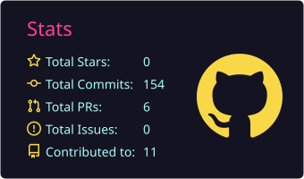
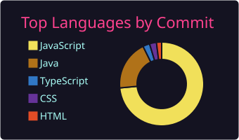

<h1 align="center">Hi, I'm João Gustavo Mendonça 👋</h1>

  <b>Software Engineer</b> · Backend & Full Stack · Computer Science Student

  
  

---

## 👨‍💻 About Me

- 🎓 B.Sc. in Computer Science (in progress)
- 🎯 Focused on **Software Engineering**, with a strong foundation in **Backend** and **Full Stack** development
- 🛠️ Hands-on experience building REST APIs with **Java + Spring Boot** and modern interfaces with **React + TypeScript**
- 🌍 Actively seeking international opportunities to grow in high-impact engineering teams

---

## 🧰 Tech Stack

**Backend**

**Frontend**

**Database**

**Tools & DevOps**

---

## 🚀 Featured Projects

| Project | Description | Stack |
|---|---|---|
| [**FocusFlow**](https://github.com/JoaoGustavo-dev/focusflow) | Productivity application designed to help users organize tasks and sustain focus. Client-side interface consuming a dedicated API. | JavaScript |
| [**JS-store**](https://github.com/JoaoGustavo-dev/JS-store) | E-commerce storefront with dynamic product rendering and DOM manipulation. | JavaScript, CSS |
| [**Carrinho-de-compras**](https://github.com/JoaoGustavo-dev/Carrinho-de-compras) | Shopping cart interface with a responsive layout and clean UI structure. | HTML, CSS |
| [**buscador-de-cep**](https://github.com/JoaoGustavo-dev/buscador-de-cep) | Postal code lookup tool that fetches address data from an external API. | JavaScript |
| [**youtube-clone**](https://github.com/JoaoGustavo-dev/youtube-clone) | Responsive recreation of the YouTube interface, focused on layout and semantic HTML. | HTML, CSS |

---

## 📊 GitHub Stats

  
  

---

## 🤝 Connect with Me

  
  

